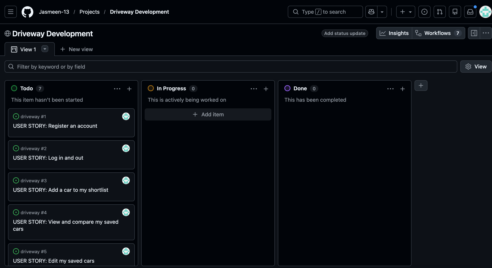

# Driveway

Driveway is a car-shortlisting application that helps users save
their own choice of cars, view photographs and compare details.

Built as an individual full-stack capstone project for the
Code Institute AI Augmented FullStack Bootcamp.

## Project Status

In development. Features listed as planned are not yet implemented.

## User Experience Design

### Target Audience

People comparing cars advertised across different websites.

### Project Goals

- Keep shortlisted cars and notes in one place.
- Display users' chosen car photographs in a smooth sliding view.
- Compare up to three cars side by side.
- Make adding, editing and deleting saved cars straightforward.

Wireframes, design decisions and a database diagram will be added
as the project develops.

## Features

### Planned for the Initial Release

- Registration, login and logout.
- Private car shortlists with frontend create, read, update and delete.
- User-entered car details and listing links.
- Manual photo uploads with image previews.
- Automatic photo import from supported sources, subject to
  feasibility and permitted access, with manual upload as a fallback.
- Sliding car-photo views and comparison of up to three cars.
- Form validation, notifications and ownership-based permissions.
- Responsive layouts and accessible interactions.

The initial photo view preserves each photograph's original background.

Screenshots will be added when features are implemented.

## Technologies

- HTML, CSS, Flexbox and Bootstrap
- JavaScript
- Python and Django
- Git and GitHub
- Heroku as the intended deployment platform

## Agile Development

## Agile Development

User stories, acceptance criteria and development tasks are tracked
in a public GitHub Projects board using Todo, In Progress and Done.

[View the project board](https://github.com/users/Jasmeen-13/projects/1)

Priorities and future features are recorded in [the backlog](docs/backlog.md).
Development progress is recorded in [the project log](docs/project-log.md).

## Testing

Initial Django configuration check:
`python manage.py check` completed with no issues.

Feature tests, permission tests, JavaScript checks, validation,
accessibility and responsive testing are still to be performed.

Expected and actual results, bugs, fixes and screenshots will be
documented as testing takes place.

## Local Setup and Deployment

Setup and Heroku deployment instructions will be completed and
verified during development.

Local secrets are stored in an ignored `env.py` file.
Production secrets will use environment variables.
Debugging must be disabled in production.

## Credits

External code, libraries and image sources will be credited here
as they are used.

## Usage of AI

ChatGPT has assisted with project planning, scope decisions,
environment setup and explanations of configuration code.

Further assistance with development, debugging and improvements
will be recorded as it occurs.

GitHub Copilot-assisted Django unit tests are planned to meet the
assessment requirements. Their generation, review and results
will be documented after completion.

## Known Limitations and Future Development

The application is not yet complete.
Automatic imports will not be guaranteed for every listing website.

See the backlog for planned future features.