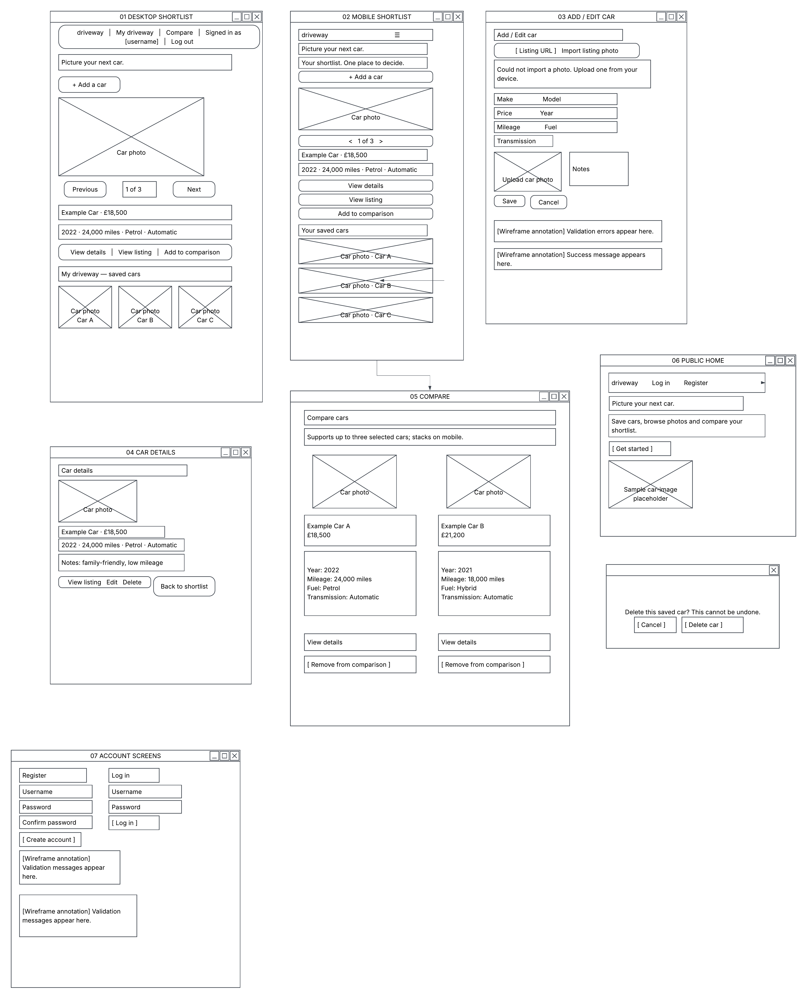
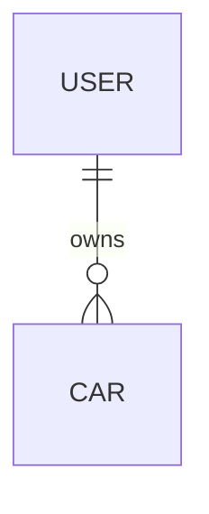
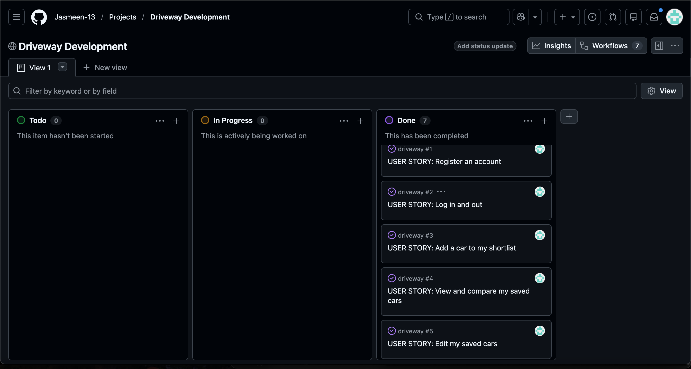

# Driveway

Driveway helps people organise cars they are considering buying.
Users can save listings from different websites, upload photographs,
record specifications and notes, and compare shortlisted cars.

This full-stack Django application was developed for the Code Institute
AI Augmented FullStack Bootcamp.

**[View the live application](https://jasmeen-driveway-fa706fcbe04a.herokuapp.com/)**

**[View the repository](https://github.com/Jasmeen-13/driveway)**

## User Experience

### Purpose and Audience

Driveway is designed for prospective car buyers who want to compare
listings without repeatedly switching between websites. Each user has
a private shortlist containing the information relevant to their decision.

### User Stories

As a prospective car buyer, I want to:

- Create an account and sign in so I can maintain a private shortlist.
- Save car specifications, photographs and listing links so I can
  organise options from different websites.
- View my saved cars in one place so I can revisit potential purchases.
- Add personal notes so I can record questions, preferences and concerns.
- Edit saved details so my shortlist reflects changes in price or information.
- Compare two or three cars so I can assess their specifications side by side.
- Delete cars, with confirmation, so I can remove unwanted options safely.
- Receive clear validation and feedback so I understand whether an action
  succeeded or needs correcting.
- Use the application on mobile and desktop so I can manage my shortlist
  across different devices.
- Keep my saved cars private so other users cannot view or modify them.

### Design

A cream background and dark green accents provide a consistent visual
identity. Bootstrap layouts adapt the navigation, forms and car cards
to different screen sizes.

Labelled form controls, keyboard-accessible interactions, a skip link
and feedback messages support usability. The comparison selection
status uses a polite live region to announce changes to assistive
technology.

### Wireframes

Desktop and mobile wireframes were created in Lucidchart to plan
the main user journeys.



[Open the full-size wireframes](docs/design/driveway-wireframes.png)

The final design uses a shortlist of car cards and a dedicated comparison
page. Automatic listing imports and sliding photo views were deferred
to prioritise a working, tested car-management experience.

## Implemented Features

| Feature | Functionality |
| --- | --- |
| Accounts | Register, log in and log out, with feedback messages. |
| Private shortlist | View saved cars belonging to the signed-in user. |
| Car management | Create, view, edit and delete cars through frontend forms. |
| Car details | Store make, model, price, year, mileage, fuel type, transmission, listing URL and notes. |
| Photographs | Upload car images, with Cloudinary storage on the deployed application. |
| Comparison | Compare two or three owned cars side by side. |
| Selection feedback | JavaScript updates the selection count, prevents a fourth selection and explains invalid submissions. |
| Validation | Django validates submitted data and comparison selections independently of JavaScript. |
| Deletion confirmation | Review the selected car before confirming deletion. |

## Data Model and Permissions

The custom `Car` model is linked to Django's user model through an
`owner` foreign key. A user can own multiple cars; each car belongs
to one user.



The model stores car specifications, an optional listing URL,
photograph and notes, alongside creation and update timestamps.

Car views require authentication. Queries are restricted to the
signed-in owner, including detail, edit, delete and comparison requests.
The owner is assigned by the server when a car is created.

## Technologies

| Technology | Purpose |
| --- | --- |
| HTML and Django templates | Page structure and dynamic content |
| CSS, Flexbox and Bootstrap | Styling and responsive layouts |
| JavaScript | Interactive comparison selection feedback |
| Python and Django | Application logic, forms, authentication and database access |
| SQLite | Local development database |
| PostgreSQL | Production database |
| Cloudinary | Persistent storage for uploaded photographs |
| WhiteNoise | Static file serving |
| Gunicorn and Heroku | Production application hosting |
| Git and GitHub | Version control and project tracking |

## Agile Development

Development was organised through user stories and acceptance criteria
on a GitHub Projects board, using **Todo**, **In Progress** and **Done**.

- [Project board](https://github.com/users/Jasmeen-13/projects/1)
- [Prioritised backlog](docs/backlog.md)
- [Development log](docs/project-log.md)



## Testing

Manual testing covered account actions, car management, comparison,
ownership restrictions, responsive layouts and browser behaviour.

Additional confirmed checks included account-form validation, keyboard
and mobile use, car-form and photo-upload validation, and secure cookies
on the deployed site. Linked screenshots were visually checked.

The automated suite contains **14 passing Django tests**, covering:

- Login requirements and private shortlist contents.
- Owner access to create, view, update and delete cars.
- Protection against another user's GET and POST requests.
- Confirmation that viewing the delete page does not delete a car.
- Valid and invalid comparison selections.
- Negative price, negative mileage and invalid future-year inputs.

The suite ran using an isolated in-memory SQLite database and local
file storage. Production services were checked separately through
manual testing of the deployed application.

Code validation included HTML and CSS validators, `pycodestyle` for
Python and JSHint for the custom JavaScript.

### Lighthouse Results

PageSpeed Insights recorded the following results for the deployed
homepage:

| Device | Performance | Accessibility | Best Practices | SEO |
| --- | --- | --- | --- | --- |
| Mobile | 98 | 100 | 100 | 100 |
| Desktop | 100 | 100 | 100 | 100 |

These scores cover the homepage and complement the manual tests.

**[Full testing results, issues and evidence](docs/testing.md)**

## Local Installation

The project uses Python 3.12.

1. Clone the repository and enter the project directory:

   ```bash
   git clone https://github.com/Jasmeen-13/driveway.git
   cd driveway
   ```

2. Create and activate a virtual environment:

   ```bash
   python3 -m venv .venv
   source .venv/bin/activate
   ```

3. Install the dependencies:

   ```bash
   python -m pip install -r requirements.txt
   ```

4. Create an `env.py` file beside `manage.py`:

   ```python
   import os

   os.environ["SECRET_KEY"] = "replace-with-a-unique-secret-key"
   os.environ["DEBUG"] = "True"
   ```

   This file is excluded from version control. Without `DATABASE_URL`
   or `CLOUDINARY_URL`, the application uses SQLite and local media
   storage.

5. Apply migrations and start the server:

   ```bash
   python manage.py migrate
   python manage.py runserver
   ```

6. Open `http://127.0.0.1:8000/`.

## Deployment

The application is deployed to Heroku through its GitHub integration.

To deploy this project:

1. Create a Heroku application and provision a PostgreSQL database.
2. Create a Cloudinary account for uploaded photographs.
3. Configure these Heroku environment variables:

   | Variable | Purpose |
   | --- | --- |
   | `SECRET_KEY` | A unique production Django secret key |
   | `DEBUG` | Set to `False` |
   | `DATABASE_URL` | PostgreSQL connection URL |
   | `CLOUDINARY_URL` | Cloudinary connection credentials |

4. Add the application's hostname to `ALLOWED_HOSTS` in
   `config/settings.py`.
5. Connect the GitHub repository and deploy the `main` branch.
6. Open the deployed application and verify its main user journeys.

The repository includes `.python-version`, `requirements.txt` and
the following `Procfile`:

```text
release: python manage.py migrate
web: gunicorn config.wsgi:application --log-file -
```

The release process applies database migrations. WhiteNoise serves
static files, while Cloudinary stores uploaded photographs.

## Credits and AI Use

Django and Bootstrap provide the framework and interface components.
Cloudinary provides photograph storage.

- **Lucidchart AI:** Used to design the initial wireframe layouts.
  I reviewed and adjusted the designs before implementation.
- **ChatGPT:** Assisted with project planning, implementation guidance,
  configuration explanations, debugging and testing.
- **GitHub Copilot:** Assisted with generating Django tests,
  implementing comparison JavaScript and correcting formatting issues.
  I reviewed the generated changes and tested their behaviour.

## Limitations and Future Development

The current release focuses on private car shortlists, manual photo
uploads, car management and comparison. The following features are
not implemented and represent potential future development.

### Listing Imports

- Import available car details and photographs from supported listing URLs
  to reduce manual entry.
- Retain manual entry and photo uploads when an import is unavailable.
- Clearly report failed or incomplete imports.

Import support would depend on each website's permitted access,
available APIs and technical restrictions.

### Driveway Visualisation

- Allow users to upload a photograph of their own driveway.
- Position and resize a car image over the driveway photograph.
- Explore background removal to improve the appearance of the car overlay.
- Explore automatic placement as a later enhancement.

### Interactive Vehicle Browsing

- Introduce smooth, modern transitions when switching between shortlisted cars.
- Create a scrolling vehicle gallery that moves from exterior photographs
  to interior views.
- Populate the gallery and car specifications from a single listing URL,
  using available photographs and details from supported sources.
- Retain manual entry and uploads when automatic imports are unavailable.

This feature would depend on permitted access to listing data and the
availability of suitable exterior and interior photographs.

### Photograph Browsing

- Support multiple photographs for each saved car.
- Add sliding photograph views for browsing shortlisted vehicles.
- Show an upload preview before saving a car.

### Vehicle Lookup

- Explore registration-number lookup through an appropriate vehicle-data
  provider to help populate supported specifications.

These ideas extend the original concept. They were deferred to prioritise
the implementation and testing of the current application's core features.
Their priorities and feasibility will be reviewed in the
[project backlog](docs/backlog.md).

### Testing Limitations

The automated suite covers selected application behaviours rather
than every possible input or integration. It runs against SQLite;
the deployed PostgreSQL and Cloudinary integrations were tested manually.

### Known Limitations

Deleting a car removes its database record, but its uploaded photo may remain in storage. Automatic orphaned-file cleanup is planned.

### Car photographs

Car photographs used in demonstration records and project screenshots
were sourced from listings on [CarGurus](https://www.cargurus.co.uk/).
Images belong to their respective owners. Driveway does not
automatically import images from CarGurus.