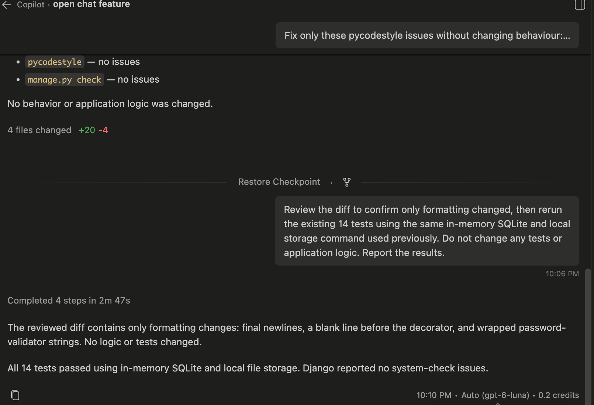
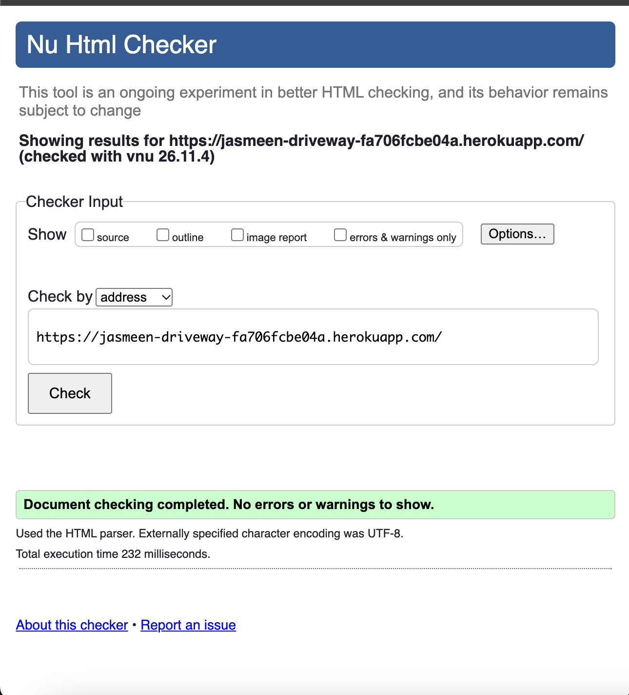
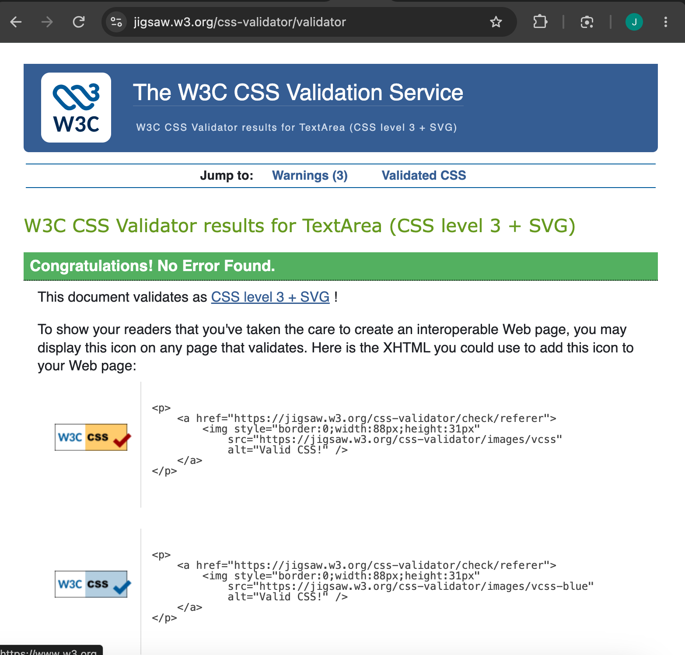
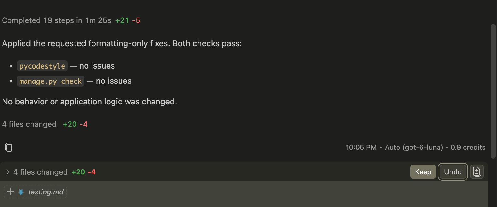
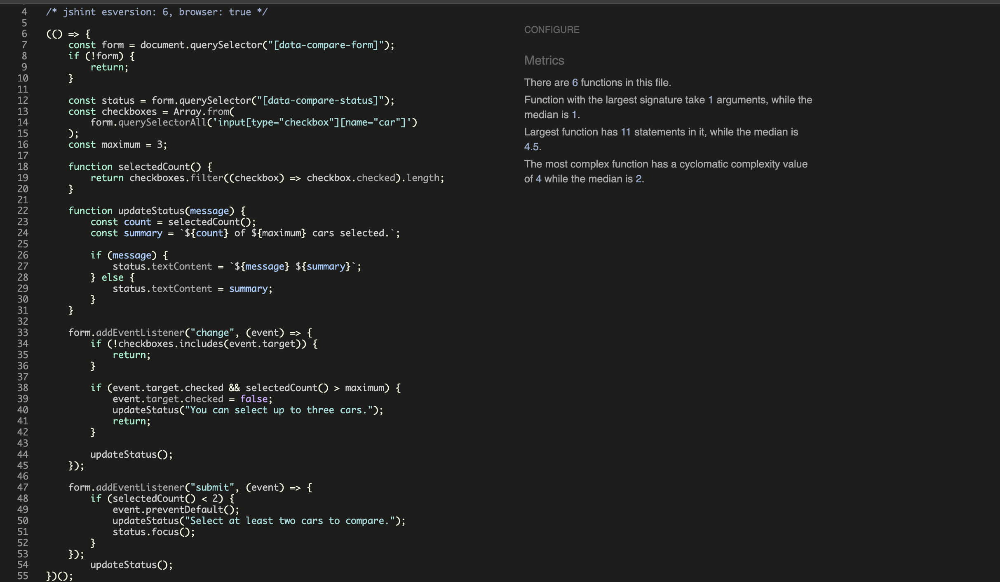
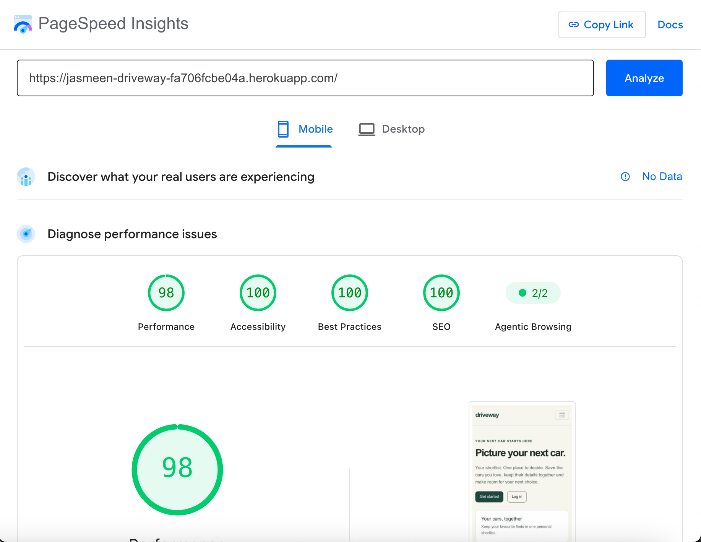
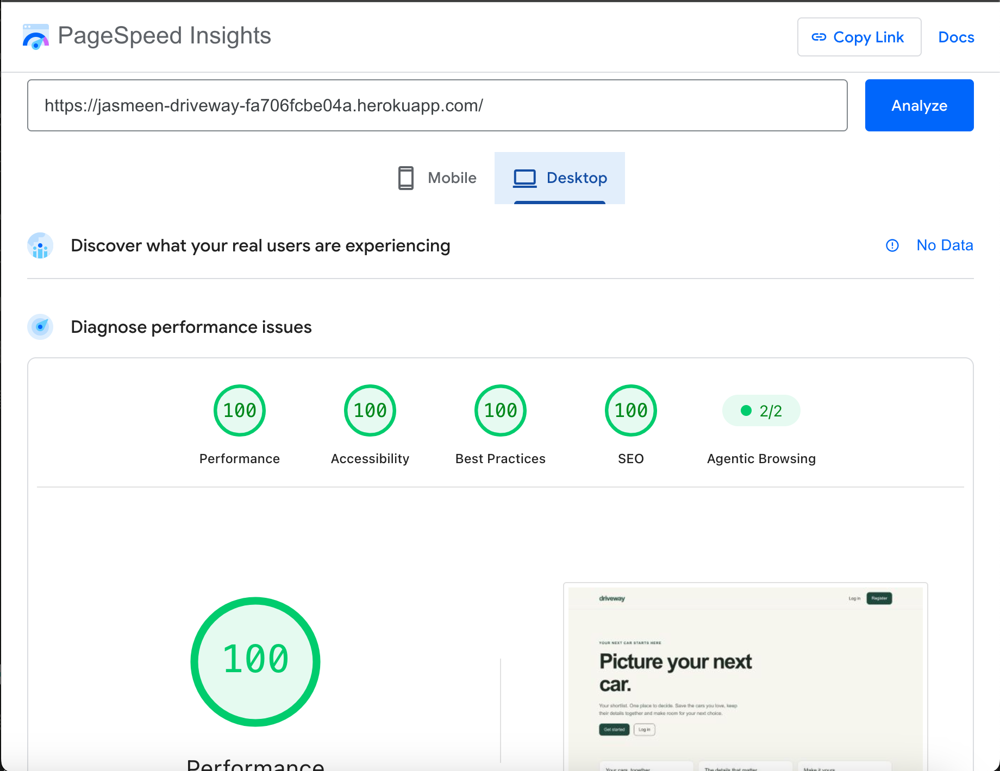

# Testing

Driveway was tested locally and on the deployed Heroku application.
Manual testing covered user journeys, permissions, responsive layouts
and JavaScript behaviour. Automated tests checked selected views and
form validation.

## Manual Testing

### Local Application

| Test | Expected result | Result |
| --- | --- | --- |
| Register | Account created, user signed in and success message displayed | Pass |
| Log in | Shortlist opens with username and success message | Pass |
| Log out | Return home with logout message | Pass |
| Add car with photo | Saved details and photograph displayed | Pass |
| Edit price | Updated price and success message displayed | Pass |
| Cancel deletion | Car remains saved | Pass |
| Confirm deletion | Car removed and success message displayed | Pass |
| Logged-out access to car details | Redirect to login | Pass |
| Second account shortlist | First account's cars are absent | Pass |
| Another user's detail, edit and delete URLs | Return 404 | Pass |
| Compare two owned cars | Selected cars and their details appear together | Pass |
| Compare one car before JavaScript enhancement | Server displays “Select two or three cars to compare.” | Pass |

### Deployed Application

| Test | Expected result | Result |
| --- | --- | --- |
| Homepage | Page and styling load correctly | Pass |
| Fresh registration | Account created and shortlist opens | Pass |
| Log out | User logged out successfully | Pass |
| Log in | User logged in successfully | Pass |
| Duplicate username, mismatched passwords or empty required registration fields | Registration is rejected | Pass |
| Invalid login credentials | A generic error is shown | Pass |
| HTTP redirect | HTTP request returns 301 with Location pointing to HTTPS URL | Pass |
| Create car with photo | Car details and photograph display | Pass |
| Persistence after Heroku restart | Saved car and photograph remain available | Pass |
| Edit price | Updated price is saved and displayed | Pass |
| Negative car price or invalid listing URL | Input is rejected and other entered details are preserved | Pass |
| Non-image upload or image over 5 MB | Upload is rejected | Pass |
| Cancel deletion | Car remains saved | Pass |
| Confirm deletion | Car card disappears from shortlist | Pass |
| Compare two cars | Both cars and correct details appear | Pass |
| Compare three cars | All three cars appear | Pass |
| Select a fourth car | Fourth selection is prevented | Pass |
| Compare one car | Selection validation message appears | Pass |
| Compare no cars | Selection validation message appears | Pass |
| Logged-out car access | Redirect to login | Pass |
| Account isolation | Other users' cars are absent from shortlist | Pass |
| Another user's detail URL | Return 404 | Pass |
| Another user's edit URL | Return 404 | Pass |
| Another user's delete URL | Return 404 | Pass |

Chrome cookie inspection confirmed that both `sessionid` and `csrftoken`
had the Secure flag checked.

### JavaScript and Keyboard Interaction

| Test | Expected result | Result |
| --- | --- | --- |
| Select and deselect cars | Selection counter updates | Pass |
| Attempt to select a fourth car | Fourth selection is rejected with an explanatory message | Pass |
| Submit zero or one selection | Submission is prevented and a helpful message appears | Pass |
| Submit two or three selections | Comparison page opens | Pass |
| Keyboard navigation | Tab reaches controls and Space toggles checkboxes | Pass |
| Invalid keyboard submission | Validation message appears and receives focus | Pass |
| JavaScript disabled | Two cars compare successfully; one selection triggers server-side validation | Pass |

### Responsive and Browser Testing

| Test | Expected result | Result |
| --- | --- | --- |
| Mobile layouts | Pages remain readable and controls remain usable | Pass |
| Mobile comparison | Car cards stack without horizontal overflow | Pass |
| Chrome | Tested account, car-management and comparison journeys work | Pass |
| Safari | Login, add, edit, delete, comparison, selection feedback and logout work | Pass |
| Account forms on mobile and with keyboard navigation | Forms remain usable | Pass |

## Automated Testing

The tests in `cars/tests.py` were created with GitHub Copilot assistance
and reviewed against the application's routes, models and forms.

**All 14 tests passed**, with no Django system-check issues.

| Area | Behaviour checked |
| --- | --- |
| Authentication requirements | Logged-out users are redirected to login |
| Account isolation | Shortlists contain only the signed-in user's cars |
| Car creation | The signed-in user is assigned as owner |
| Owner access | Owners can view, edit and delete their cars |
| Delete confirmation | GET requests do not delete cars |
| Unauthorised GET requests | Another user's detail, edit and delete pages return 404 |
| Unauthorised POST requests | Another user cannot edit or delete a car |
| Valid comparison | Two or three owned cars are returned |
| Invalid comparison | Zero, one, four, malformed or another user's selections are rejected |
| Form validation | Negative price, negative mileage and years beyond next year are rejected |

Tests used an isolated in-memory SQLite database and local file storage,
rather than the production PostgreSQL database or Cloudinary.



### Running the Automated Tests

With dependencies installed and local environment settings configured,
run this command from the project root:

```bash
./.venv/bin/python -c 'import os; os.environ.setdefault("DJANGO_SETTINGS_MODULE", "config.settings"); from django.conf import settings; settings.DATABASES = {"default": {"ENGINE": "django.db.backends.sqlite3", "NAME": ":memory:"}}; settings.STORAGES = {"default": {"BACKEND": "django.core.files.storage.FileSystemStorage"}, "staticfiles": {"BACKEND": "django.contrib.staticfiles.storage.StaticFilesStorage"}}; settings.SECURE_SSL_REDIRECT = False; import django; django.setup(); from django.core.management import call_command; call_command("test", "cars.tests", verbosity=2)'
```

HTTPS redirection is disabled only within this isolated test process.
All 14 tests passed again after the password-validator and security
configuration changes.

### Test Limitations

The automated suite does not test registration/login form processing,
image uploads or CSRF enforcement. Authenticated view tests use
`force_login`. Account journeys and photograph uploads were checked
manually.

## HTML Validation

Rendered HTML was checked using the Nu HTML Checker. For pages requiring
login, the rendered page source was submitted rather than the Django
template code.

| Page | Result | Evidence |
| --- | --- | --- |
| Homepage | No errors or warnings | [Homepage validation](screenshots/html-validation-home.png) |
| Registration | Passed | [Registration validation](screenshots/html-validation-register.png) |
| Login | Passed | [Login validation](screenshots/html-validation-login.png) |
| Shortlist | No errors or warnings | [Shortlist validation](screenshots/html-validation-shortlist.png) |
| Add car | Passed | [Add-car validation](screenshots/html-validation-add-car.png) |
| Edit car | Passed | [Edit-car validation](screenshots/html-validation-edit-car.png) |
| Car details | Passed | [Car-details validation](screenshots/html-validation-car-detail.png) |
| Comparison | Passed | [Comparison validation](screenshots/html-validation-compare.png) |
| Delete confirmation | Passed | [Delete-page validation](screenshots/html-validation-delete.png) |



## CSS Validation

The project's stylesheet passed the W3C CSS Validator.



## Python Validation

Python formatting was checked with:

```bash
./.venv/bin/python -m pycodestyle cars config manage.py --exclude=migrations
```

Missing final newlines, blank-line spacing and long lines were corrected.
The subsequent check reported no issues. Django's system check and all
14 automated tests also passed after the formatting changes.



## JavaScript Validation

`static/js/compare.js` passed JSHint with no warnings using
`esversion: 6` and `browser: true`.

An initial warning about a line break before a conditional operator
was resolved by rewriting the status-message assignment as an
`if/else` statement.

The selection counter, three-car limit, minimum-selection feedback
and keyboard interaction were also tested manually.



## Lighthouse

PageSpeed Insights recorded these results for the deployed homepage:

| Device | Performance | Accessibility | Best Practices | SEO |
| --- | --- | --- | --- | --- |
| Mobile | 98 | 100 | 100 | 100 |
| Desktop | 100 | 100 | 100 | 100 |

These results cover the homepage only. Automated accessibility scores
complement manual testing; they do not establish that every page or
interaction is fully accessible.

### Mobile



### Desktop



## Issues and Follow-up

| Issue | Action and outcome |
| --- | --- |
| A car card initially appeared to remain after deletion | The cause was not established. Subsequent deployed deletion tests passed. Automated tests also confirmed that POST deletion removes the record. |
| Python formatting warnings | Corrected whitespace, final newlines and line wrapping; validation then passed. |
| JSHint conditional-expression warning | Replaced the expression with an equivalent `if/else`; validation then passed. |

### Evidence Review

All linked screenshots were visually checked and are readable.